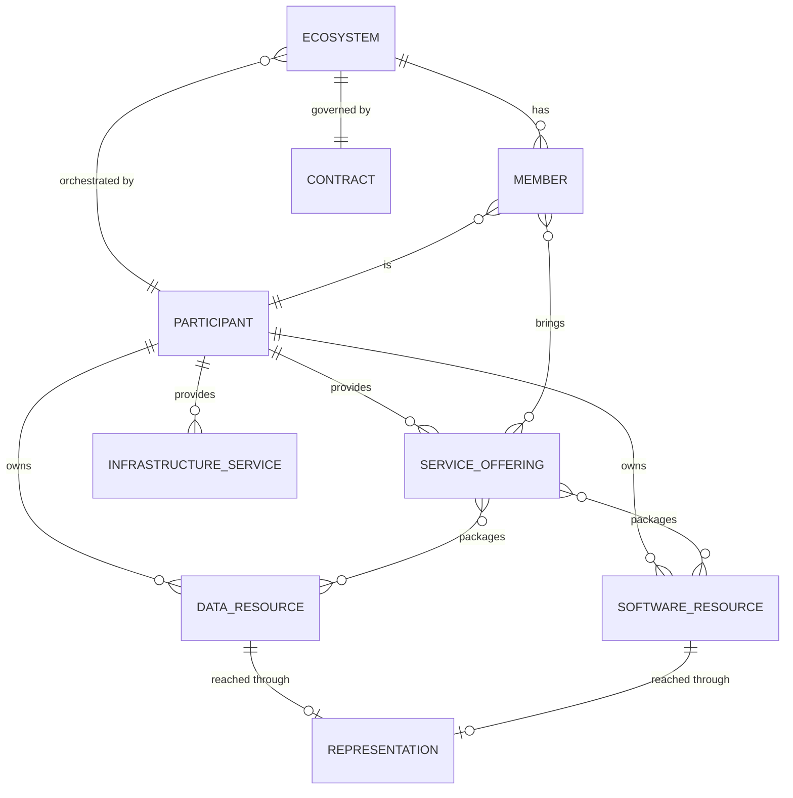

# Catalogue

The catalogue is the front door of a dataspace. Participants register in it, describe their data and services, find each other, build use cases and negotiate. It is also, today, where each organisation's identity lives.

| | |
| --- | --- |
| **Open-source implementation** | [catalog-api]({{ ptx_github }}/catalog-api) |
| **Operator implementation** | [{{ operator.name }}]({{ operator.app_url }}), user documentation at [{{ operator.docs_url }}]({{ operator.docs_url }}) |
| **Used by** | Participants (through a web interface), connectors, the Contract Manager, the Consent Manager |

## What it does

- **Onboarding.** Creates the participant (the organisation) and its administrator accounts, and issues the organisation's API keys used by its connector.
- **Description of offers.** Stores data resources, software resources, offers and infrastructure offers, including their *representations* (how a connector reaches them).
- **Discovery.** Lets participants browse offers and use cases, and recommends matches based on categories.
- **Use cases.** Creation, invitations and join requests, roles, rules, building-block requirements, service chains.
- **Negotiation.** Proposals and counter-proposals on offers, policies and pricing, for use cases and for bilateral agreements.
- **Contract orchestration.** Creates contracts in the [Contract Manager](contract-manager.md), injects the negotiated policies and records signatures.
- **Connector registration.** Records the address of each participant's connector when the connector starts.

## Self-descriptions

Every participant, resource, offer, infrastructure offer and use case has a public description at a stable URL:

```
GET {catalogue}/catalog/participants/{id}
GET {catalogue}/catalog/serviceofferings/{id}
GET {catalogue}/catalog/dataresources/{id}
GET {catalogue}/catalog/softwareresources/{id}
GET {catalogue}/catalog/infrastructureservices/{id}
GET {catalogue}/catalog/ecosystems/{id}
```

These URLs are the identifiers used everywhere else: contracts, consents and connectors refer to participants and offers by them. Responses are JSON with `@context` and `@type` fields, and their field names follow the Gaia-X Trust Framework (for example `providedBy`, `aggregationOf`, `containsPII`, `legalPerson`).

For {{ operator.name }}, `{catalogue}` is `{{ operator.catalog_uri }}`.

## DCAT export

The open-source catalogue can also export data resources, software resources and offers in a DCAT 3 form, for use by DCAT-based catalogues. Catalogue federation across dataspaces is being specified in [DSIF](../interoperability/dsif.md#catalogue-federation), using DCAT-AP.

## Authentication

| Who | How |
| --- | --- |
| People (organisation administrators) | Account with email and password, through the web interface |
| Connectors | The organisation's service key and secret key, set in the connector's configuration |
| Contract Manager | The catalogue authenticates to the Contract Manager as the operator |

Organisation identities will move to verifiable credentials held in wallets: see [Identity and trust](../learn/identity-and-trust.md).

## API overview (catalog-api)

| Group | Main routes | Purpose |
| --- | --- | --- |
| Authentication | `/auth/signup`, `/auth/login` | Create an organisation and log in |
| Self-descriptions | `/catalog/*` | Public descriptions (see above) |
| Resources and offers | `/dataresources`, `/softwareresources`, `/serviceofferings`, `/infrastructureservices`, `/representations` | Manage what you publish |
| Use cases | `/ecosystems`, `/ecosystems/{id}/invites`, `/ecosystems/{id}/requests`, `/ecosystems/{id}/offerings`, `/ecosystems/{id}/signature/...` | Create a use case, manage members, sign |
| Service chains | `/ecosystems/{id}/adddataprocessingchain`, `/ecosystems/{id}/updatedataprocessingchain/{chainId}` | Build chains |
| Bilateral negotiation | `/negotiation`, `/negotiation/{id}/negotiate`, `/negotiation/{id}/accept`, `/negotiation/{id}/sign` | Agree on a bilateral contract |
| Connectors | `/participants`, `/participants/check` | Register a connector and check its registration |

The full API is documented with OpenAPI in the repository. {{ operator.name }} exposes equivalent features, with some routes named differently (for example bilateral negotiation is handled through *exchange configurations*).

## Data model



## Operator-specific features

Operators can add their own features on top. {{ operator.name }}, for example, adds:

- organisation visibility (public or private) and access by invitation;
- paid publication of use cases;
- a **Tech Space** sandbox to test a connector against reference connectors;
- **exchange triggers**, to start exchanges from the web interface;
- **hosted connectors** for participants who do not want to run their own.

These are documented at [{{ operator.docs_url }}]({{ operator.docs_url }}).
