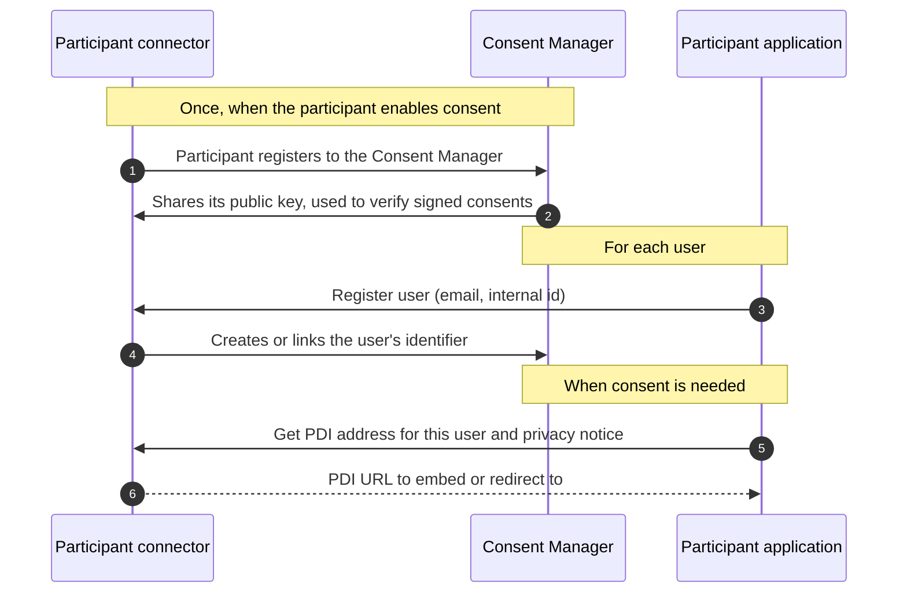
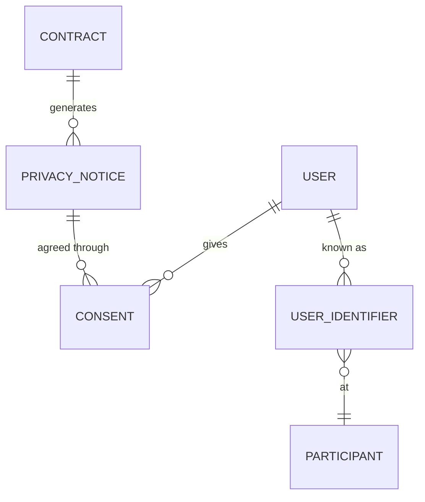

# Consent Manager

The Consent Manager handles everything related to individuals' personal data. It generates privacy notices from contracts, records consents, links the accounts a person has at different organisations, and starts consent-based exchanges between connectors. It is the back end of the personal data intermediary (PDI) where individuals manage their consents.

| | |
| --- | --- |
| **Repository** | [consent-manager]({{ ptx_github }}/consent-manager) |
| **Used by** | Individuals (through the PDI), participants' connectors and applications |
| **{{ operator.name }} address** | `{{ operator.consent_uri }}` |

To understand the concepts first, read [Personal data and consent](../learn/personal-data-and-consent.md).

## What it does

- **Privacy notices.** Reads signed contracts from the [Contract Manager](contract-manager.md) and the descriptions of offers from the [Catalogue](catalogue.md), and builds one privacy notice per contract and provider.
- **Consents.** Records consents given or refused by individuals, their history, and exports them as receipts following ISO/IEC TS 27560.
- **Starting exchanges.** When an individual consents, sends a signed consent to the provider's and consumer's connectors, which then exchange the data.
- **Consent checks.** Connectors check with the Consent Manager that a consent is still valid before data moves.
- **Identity of individuals.** Holds individuals' accounts and links the identifiers each organisation uses for the same person.
- **PDI.** Serves the consent interface that participants embed in their applications.

## How it fits with connectors



## Data model



- **User**: one person, identified by email.
- **User identifier**: how one participant knows this person (its internal identifier and the email it holds).
- **Privacy notice**: data, purposes, recipients and processing steps, generated from a contract.
- **Consent**: one decision of a user on a privacy notice, with status, history and the identifiers to use at the provider and the consumer.

A consent receipt looks like this (abridged):

```json
{
  "record": { "schemaVersion": "0.2.0", "recordId": "...", "piiPrincipalId": "..." },
  "piiProcessing": {
    "privacyNotice": "...",
    "language": "en",
    "purposes": [{
      "purpose": "Career guidance",
      "lawfulBasis": "consent",
      "piiControllers": ["https://.../participants/provider", "https://.../participants/consumer"]
    }]
  },
  "event": [{ "eventTime": "...", "eventType": "explicit", "eventState": "consent given" }],
  "partyIdentification": [
    { "partyId": "https://.../participants/consumer", "partyType": "consumer" },
    { "partyId": "https://.../participants/provider", "partyType": "provider" }
  ]
}
```

## API overview

All routes are under `/v1`.

| Group | Main routes | Purpose |
| --- | --- | --- |
| Participants | `POST /participants`, `POST /participants/login` | Register a participant and authenticate it |
| Users | `POST /users/register`, `POST /users/registers` | Register one or many users of a participant |
| Individuals | `POST /users/signup`, `POST /users/login`, `GET /users/me` | Individuals' own accounts |
| Privacy notices | `GET /consents/{userId}/{provider}/{consumer}`, `GET /consents/privacy-notices/{id}` | Get the notices that apply to a user |
| Consents | `POST /consents`, `GET /consents/me`, `DELETE /consents/{id}` | Give, list and withdraw consent |
| Exchange | `POST /consents/{id}/data-exchange`, `POST /consents/{id}/resume` | Start or resume the exchange tied to a consent |
| PDI | `GET /consents/pdi/iframe` | Consent interface |

The full API is documented with OpenAPI at `/docs` on the service. Most participants never call it directly: their connector does it for them (see [Personal data (optional)](../participants/personal-data.md)).

## Consent agent (optional)

The Consent Manager can include the **consent agent**, a rule-based helper that learns an individual's preferences (by provider, category, time or place) and recommends the privacy notices that match them. Recommendations are advisory: consent is always given explicitly by the individual. It is part of the [contract and consent agent]({{ ptx_github }}/contract-consent-agent) building block.

## Deployment notes

- MongoDB must run as a replica set, because the consent agent uses change streams.
- The service needs a key pair to sign consents; npm scripts in the repository generate it.
- Docker, Helm and Terraform deployment files are provided.
