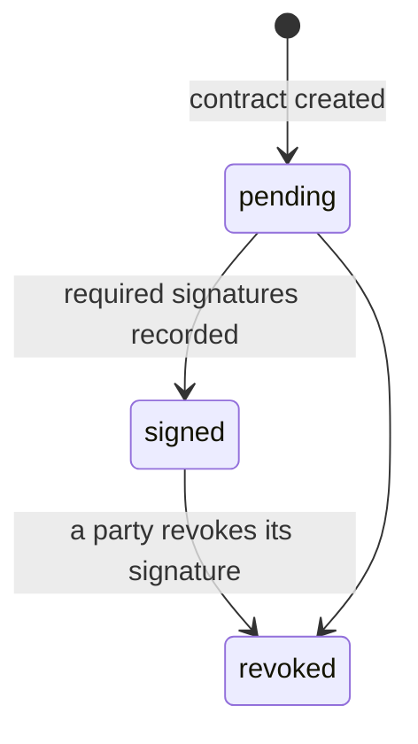

# Contract Manager

The Contract Manager stores the contracts of the dataspace: multi-party **ecosystem contracts** for use cases, and two-party **bilateral contracts**. It builds their policies from the registry's templates, records signatures and holds the service chains of use cases.

| | |
| --- | --- |
| **Repository** | [contract-manager]({{ ptx_github }}/contract-manager) |
| **Written by** | The catalogue only, on behalf of participants |
| **Read by** | Connectors (on every exchange) and the Consent Manager |
| **{{ operator.name }} address** | `{{ operator.contract_uri }}` |

## What it does

- Creates contracts when the catalogue asks for it: an ecosystem contract when a use case is set up, a bilateral contract when a provider accepts a consumer's request.
- **Builds policies** from [Catalog Registry](catalog-registry.md) templates and the values agreed in negotiation, then attaches them to an offer, a role or the whole contract.
- **Records signatures and revocations**, and moves the contract through its statuses.
- **Stores service chains** defined by the orchestrator of a use case.
- Serves contracts to connectors, which evaluate the policies themselves.

## Contract lifecycle



| Contract type | Becomes signed when |
| --- | --- |
| Ecosystem | The orchestrator and at least one other member have signed |
| Bilateral | Both the provider and the consumer have signed |

Members who join a use case later sign the same ecosystem contract. If a party revokes its signature, the contract becomes revoked and connectors stop exchanges under it.

## What a contract contains

=== "Ecosystem contract"

    ```json
    {
      "ecosystem": "https://catalogue.example/v1/catalog/ecosystems/abc",
      "orchestrator": "https://catalogue.example/v1/catalog/participants/p0",
      "members": [
        { "participant": "https://catalogue.example/v1/catalog/participants/p0", "role": "orchestrator", "signature": "...", "date": "..." },
        { "participant": "https://catalogue.example/v1/catalog/participants/p1", "role": "participant", "signature": "...", "date": "..." }
      ],
      "serviceOfferings": [{
        "participant": "https://catalogue.example/v1/catalog/participants/p1",
        "serviceOffering": "https://catalogue.example/v1/catalog/serviceofferings/so1",
        "policies": [{ "permission": [{ "action": "use", "target": "...", "constraint": [] }] }]
      }],
      "rolesAndObligations": [{ "role": "dataProvider", "policies": [] }],
      "serviceChains": [{ "catalogId": "chain-1", "services": [{ "participant": "...", "service": "..." }] }],
      "status": "signed"
    }
    ```

=== "Bilateral contract"

    ```json
    {
      "dataProvider": "https://catalogue.example/v1/catalog/participants/p1",
      "dataConsumer": "https://catalogue.example/v1/catalog/participants/p2",
      "serviceOffering": "https://catalogue.example/v1/catalog/serviceofferings/so1",
      "purpose": [{ "purpose": "https://catalogue.example/v1/catalog/serviceofferings/so2" }],
      "policy": [{ "permission": [{ "action": "use", "target": "...", "constraint": [] }] }],
      "signatures": [
        { "did": "https://catalogue.example/v1/catalog/participants/p1", "party": "provider", "value": "...", "date": "..." },
        { "did": "https://catalogue.example/v1/catalog/participants/p2", "party": "consumer", "value": "...", "date": "..." }
      ],
      "status": "signed"
    }
    ```

Participants and offers are identified by their catalogue URLs.

## API overview

| Group | Main routes | Purpose |
| --- | --- | --- |
| Ecosystem contracts | `GET /contracts/{id}`, `POST /contracts`, `GET /contracts/for/{participant}` | Read, create and list contracts |
| Signatures | `PUT /contracts/sign/{id}`, `DELETE /contracts/sign/revoke/{id}/{participant}` | Sign and revoke |
| Policies | `PUT /contracts/policies/{id}`, `PUT /contracts/policies/offering/{id}`, `PUT /contracts/policies/role/{id}` | Inject policies for the contract, an offer or a role |
| Offer policies | `GET /contracts/serviceoffering/{id}` | Policies that apply to one offer in a contract |
| Service chains | `GET`/`POST /contracts/{id}/servicechains`, `PUT .../insert`, `PUT .../update/{chainId}` | Manage the chains of a use case |
| Bilateral contracts | `GET /bilaterals/{id}`, `POST /bilaterals`, `PUT /bilaterals/sign/{id}`, `PUT /bilaterals/policies/{id}` | Same operations for bilateral contracts |

Participant URLs in path parameters are Base64-encoded. The full API is documented with OpenAPI at `/docs` on the service.

Write operations are reserved to the catalogue. Participants change contracts by negotiating and signing in the catalogue.

## DSP negotiation records

When a Prometheus-X participant negotiates a bilateral contract with a DSP-based dataspace ([Contract negotiation over DSP](../interoperability/dsp-and-edc.md#contract-negotiation-over-dsp)), the Contract Manager keeps a record of the negotiation in the shape defined by the Eclipse Dataspace Protocol: consumer and provider process identifiers, offer, agreement, callback address and negotiation state (from `REQUESTED` to `FINALIZED` or `TERMINATED`).

| Route | Purpose |
| --- | --- |
| `POST /dsp`, `PUT /dsp/{id}` | Create and update a negotiation record |
| `GET /dsp/{id}`, `GET /dsp/all` | Read negotiation records |
| `GET /dsp/agreement/{id}` | Find a negotiation by its agreement |

As with other contracts, the catalogue writes these records on behalf of participants.

## Automated negotiation (optional)

The Contract Manager can include the **contract agent**, a rule-based helper that checks a proposal against a participant's preferences and says whether it can be accepted, and which policies or services are unacceptable. It is part of the [contract and consent agent]({{ ptx_github }}/contract-consent-agent) building block.

## Configuration

| Variable | Purpose |
| --- | --- |
| `MONGO_URL` | Database |
| `SERVER_PORT` | Port (8888 by default) |
| `CATALOG_REGISTRY_URL` | Where to fetch policy templates |
| `CATALOG_AUTHORIZATION_KEY` | Key the catalogue uses to authenticate |
| `USE_CONTRACT_AGENT` | Enables the contract agent |
