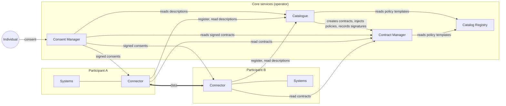

# Core components

The core of Prometheus-X is made of five components. Four are shared services run by the dataspace operator; the fifth, the connector, is used by every participant.

| Component | What it does | Run by | Repository |
| --- | --- | --- | --- |
| [Catalogue](catalogue.md) | Participants, offers, use cases, negotiation; organisations' identity | Operator | [catalog-api]({{ ptx_github }}/catalog-api) |
| [Catalog Registry](catalog-registry.md) | Reference models: policy templates, roles, categories | Operator | [catalog-registry]({{ ptx_github }}/catalog-registry) |
| [Contract Manager](contract-manager.md) | Ecosystem and bilateral contracts, policies, signatures, service chains | Operator | [contract-manager]({{ ptx_github }}/contract-manager) |
| [Consent Manager](consent-manager.md) | Privacy notices, consents, individuals' identities | Operator | [consent-manager]({{ ptx_github }}/consent-manager) |
| [Dataspace Connector (PDC)](../connector/index.md) | Checks contracts, policies and consent; moves the data | Each participant (or a host on its behalf) | [dataspace-connector]({{ ptx_github }}/dataspace-connector) |

## How they talk to each other

Some rules of thumb:

- **Participants act through the catalogue.** They never write to the Contract Manager directly: the catalogue creates contracts, injects the negotiated policies and records signatures on their behalf.
- **Connectors read, they do not write.** A connector reads descriptions from the catalogue and contracts from the Contract Manager, then decides on its own whether an exchange is allowed.
- **The Consent Manager builds on contracts.** It turns signed contracts into privacy notices and sends the resulting consents to the connectors.

## Shared characteristics

- **Stack**: Node.js and TypeScript, Express, MongoDB.
- **APIs**: REST and JSON, documented with OpenAPI (Swagger) on each service.
- **Deployment**: Docker images for every component.
- **Licence**: MIT.

To run them yourself, see [Running the core services](operating.md).

## Open-source code and operator implementations

The repositories above are the open-source reference implementations. An operator can run them as they are or build its own implementation of the same interfaces. {{ operator.name }} builds its catalogue on `catalog-api` and has extended it with a full web interface, richer negotiation and use-case management, and services such as hosted connectors and a connector test sandbox. Its contract and consent services implement the same interfaces as the open-source Contract Manager and Consent Manager, so connectors work the same way against either.
