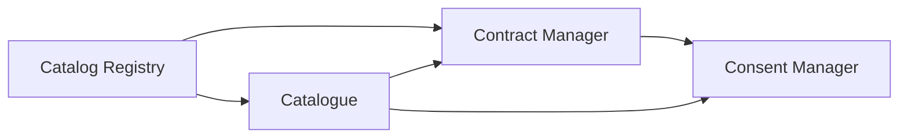

# Running the core services

Most participants join a dataspace that an operator already runs, such as {{ operator.name }}. This page is for those who want to run the core services themselves: to try Prometheus-X locally, to develop against it, or to operate a dataspace.

## Try a complete dataspace locally

The [ptx-docker]({{ ptx_github }}/ptx-docker) repository starts a full Prometheus-X dataspace with Docker Compose: the four core services, a database with sample data, and three participants (provider, consumer, infrastructure provider), each with a connector and a mock API.

```bash
git clone {{ ptx_github }}/ptx-docker.git
cd ptx-docker
cp .env.sample .env
./check-configuration.sh
docker compose --profile "*" up -d --build
```

| Profile | Starts |
| --- | --- |
| `db` | MongoDB and the sample data |
| `core` | Catalog Registry, Catalogue, Contract Manager, Consent Manager |
| `provider` | A provider connector and its mock API |
| `consumer` | A consumer connector and its mock API |
| `infrastructure` | An infrastructure provider's connector and its mock service |

| Service | Port |
| --- | --- |
| Catalog Registry | 3000 |
| Catalogue | 4040 |
| Contract Manager | 8888 |
| Consent Manager | 8887 |
| Provider connector and API | 3333, 3334 |
| Consumer connector and API | 3335, 3336 |
| Infrastructure connector and service | 3337, 3338 |

The sample data includes participants, offers, a use case, signed contracts and consent users, so you can trigger a standard, a consent-based and a service-chain exchange straight away. The sample accounts and example requests are listed in the repository README.

## Running a dataspace

To operate a dataspace, you deploy the four core services, then onboard participants in your catalogue. Participants point their connectors at your services.



Deploy them in this order, since each one needs the address of the previous ones.

### Catalog Registry

| Setting | Purpose |
| --- | --- |
| `MONGO_*` | Database |
| `API_URL`, `PORT` | Public address and port |
| `API_KEY` | Protects the synchronisation jobs |
| `instance.config.json` | Categories specific to your dataspace |

Initialise it with `pnpm clone:reference-models` then `npm run db:init`.

### Catalogue

| Setting | Purpose |
| --- | --- |
| `MONGO_*` | Database |
| `API_URL`, `API_PREFIX` | Public address; it becomes the base of every participant and offer identifier |
| `JWT_SECRET_KEY` | Signs user sessions |
| `CONTRACT_SERVICE_ENDPOINT` | Contract Manager address |
| `X_PTX_CONTRACT_CATALOG_KEY` | Key used to authenticate to the Contract Manager |

!!! warning "Choose the public address first"
    Participants, offers and contracts are identified by URLs built from the catalogue's public address. Changing it later breaks every existing identifier.

### Contract Manager

| Setting | Purpose |
| --- | --- |
| `MONGO_URL` | Database |
| `SERVER_PORT` | Port |
| `CATALOG_REGISTRY_URL` | Catalog Registry address, to fetch policy templates |
| `CATALOG_AUTHORIZATION_KEY` | Must match the catalogue's key |
| `USE_CONTRACT_AGENT` | Enables the automated negotiation helper |

### Consent Manager

| Setting | Purpose |
| --- | --- |
| `MONGO_URI` | Database, as a MongoDB replica set |
| `API_PREFIX` | Usually `/v1` |
| `CONTRACT_SERVICE_BASE_URL` | Contract Manager address |
| `PDI_ENDPOINT` | Address of the consent interface |
| `JWT_SECRET_KEY`, `SESSION_SECRET` | Session and token signing |
| Mail settings | Email confirmations sent to individuals |
| `PRIVACY_RIGHTS`, `WITHDRAWAL_METHOD`, and related | Default values shown in consent receipts |

Generate the consent signing keys with the npm scripts in the repository before the first start.

## Production checklist

- Serve every service over HTTPS with valid certificates.
- Use a managed or replicated MongoDB, with backups.
- Generate strong, unique values for every key and secret, and keep them out of version control.
- Restrict write access to the Contract Manager to your catalogue.
- Monitor the availability of each service: connectors depend on the catalogue, the Contract Manager and the Consent Manager for every exchange.
