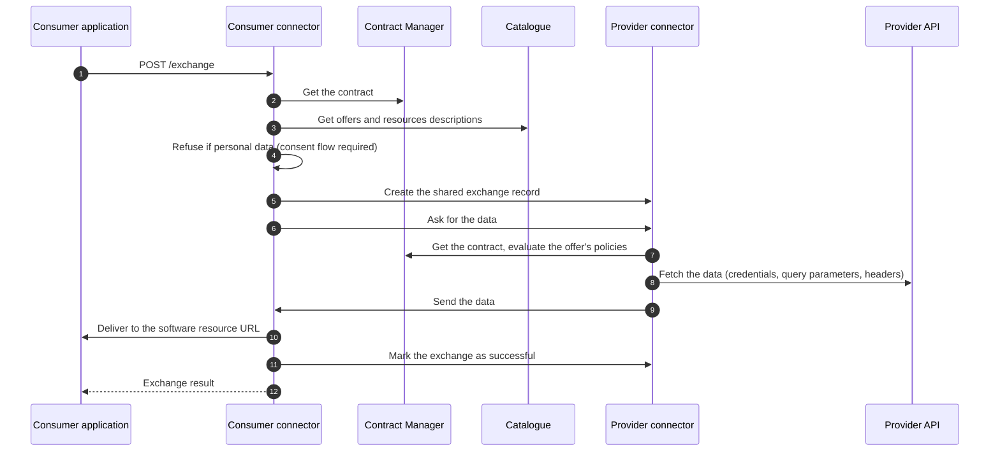
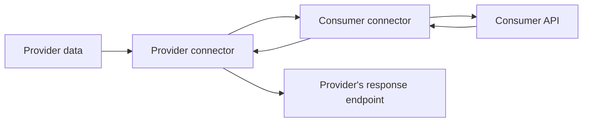
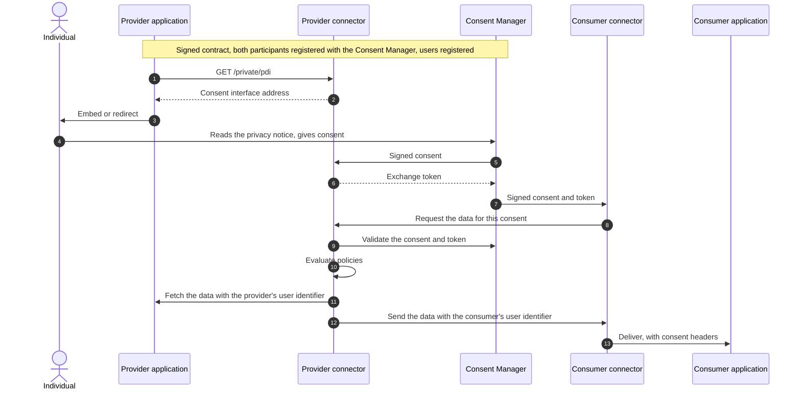
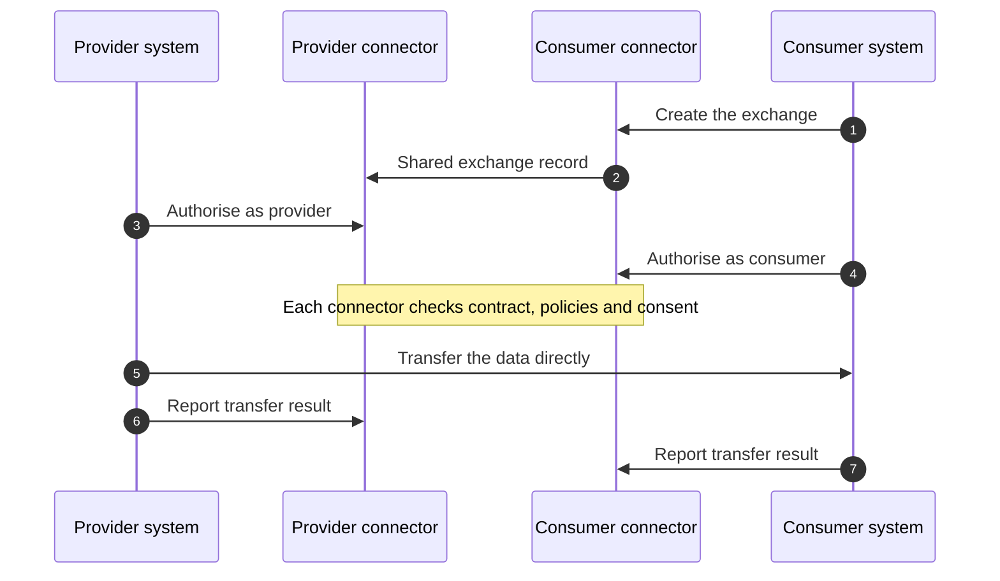

# Exchange flows

Exchanges vary along two axes: the **contract** (use-case or bilateral) and the **data** (non-personal or personal). On top of these, three variants exist: **API consumption**, **service chains** and **control-plane-only**. This page describes each one.

| Flow | When to use it |
| --- | --- |
| [Business-to-business](#business-to-business-exchange) | Non-personal data from a provider to a consumer's service |
| [API consumption](#api-consumption) | A provider sends its data to a consumer's API and gets the result back |
| [Consent-based](#consent-based-exchange) | Personal data, triggered by the individual's consent |
| [Service chains](#service-chains) | Data goes through processing steps between provider and consumer |
| [Control-plane-only](#control-plane-only-mode) | The connectors authorise, your own systems move the data ({{ pdc_next }}) |

## Triggering an exchange

Any party to the contract can trigger an exchange on its own connector.

```bash
curl -X POST https://pdc.your-organisation.eu/exchange \
  -H "Authorization: Bearer <admin token>" \
  -H "Content-Type: application/json" \
  -d '{
    "contract": "{{ operator.contract_uri }}contracts/<id>",
    "purposeId": "<consumer offer URL>",
    "resourceId": "<provider offer URL>",
    "resources": [{ "resource": "<data resource URL>", "params": { "query": [{ "from": "2026-01-01" }] } }]
  }'
```

| Field | Meaning |
| --- | --- |
| `contract` | URL of the contract. Use-case contracts contain `/contracts/`, bilateral ones `/bilaterals/`. |
| `purposeId` | The consumer's offer. Required for use-case contracts; for bilateral contracts the connector takes it from the contract. |
| `resourceId` | The provider's offer. Same rule as `purposeId`. |
| `resources` | Optional: restrict to some data resources and pass query parameters to each. |
| `serviceChainId` | Optional: run a service chain defined in the contract. |
| `data` | Optional: send this payload instead of fetching it from the provider. |
| `directResponseVisualization` | Optional: return the consumer application's response to the caller (connector 1.11.0+, not for consent flows). |

The call waits until the exchange finishes or times out (`EXCHANGE_TIMEOUT`), then returns the exchange record and its status.

Exchanges can also be started from the operator's interface with **exchange triggers** (see [Run your first exchange](../participants/first-exchange.md)).

## Business-to-business exchange



The provider's connector always evaluates its own offer's policies before fetching any data. If the provider triggers the exchange, it runs the same steps starting from its side.

## API consumption

In this variant, the provider sends its data to the consumer's API, and the API's response comes back to the provider.



Set up:

- the provider's data resource is marked as **payload for an API**, with a response representation saying where the result goes;
- the consumer's software resource is marked as an **API**.

## Consent-based exchange

Personal data is exchanged only when the individual consents. The consent starts the exchange.



Points to note:

- If the consumer does not know the person yet, the consent waits while the consumer's connector asks the application (`registrationUri`) to create the account, then resumes.
- Consents can also select one of the service chains of the contract.
- `directResponseVisualization` is not available in consent flows.

## Service chains

A chain is defined by the orchestrator in the use-case contract. Triggering it:

```json
{
  "contract": "{{ operator.contract_uri }}contracts/<id>",
  "serviceChainId": "<chain id from the contract>"
}
```

Then:

1. The triggering connector creates the exchange record on every connector of the chain and starts the chain.
2. The first node (the provider) fetches the data and sends it to the second node.
3. Each intermediate connector checks its service is part of the chain in the contract, re-checks consent if any, and calls its service with `{ data, contract, params, previousNodeParams }`.
4. The service processes the data and calls `POST /service-chain/resume` on its connector, or the connector does it automatically if `serviceChainAdapter` is enabled.
5. The last node (the consumer) delivers the result.

Requirements and limits:

- connectors 1.9.0 or later on every node;
- every member of the chain has signed the contract;
- JSON data;
- one input per node, no nested chains;
- a node can pull additional data from other providers before processing; the connector merges it as `{ "origin": [...], "additionalData": [...] }`.

## Control-plane-only mode

!!! info "Connector {{ pdc_next }}, opt-in"
    This mode is part of connector version {{ pdc_next }}, in development at the time of writing.

In the default flows, data passes through both connectors. In **control-plane-only mode**, the connectors only authorise the exchange; the participants' own systems move the data, with any protocol they choose (direct HTTPS, S3, SFTP...). This suits large files, streaming, or existing transfer pipelines.



1. **Create** the exchange: `POST /controlplane/exchanges` (or the trigger and consent variants).
2. **Authorise**: each side calls `POST /controlplane/exchanges/{id}/authorize` on its own connector, which evaluates the contract, policies and consent. An authorisation is valid for 5 minutes.
3. **Transfer** the data between your systems.
4. **Report**: each side calls `POST /controlplane/exchanges/{id}/transfer` with the result and metadata (checksum, MIME type, size).
5. **Follow** the exchange with `GET /controlplane/exchanges/{id}`, or with webhooks (`exchange.created`, `participant.authorized`, `participant.denied`, `transfer.completed`, `transfer.failed`).

Enable it with `controlPlaneEnabled: true` and optionally `controlPlaneWebhookUrls`. Service chains are not available in this mode.
