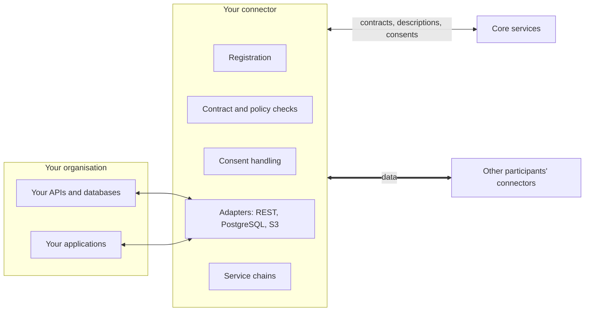

# Dataspace Connector (PDC)

The Prometheus-X Dataspace Connector (PDC) is the software each participant uses to take part in exchanges. It sits between the participant's own systems (APIs, databases, applications) and the rest of the dataspace.

| | |
| --- | --- |
| **Repository** | [dataspace-connector]({{ pdc_repo }}) (MIT licence) |
| **Detailed guides** | [Connector wiki]({{ pdc_wiki }}) |
| **Latest release** | {{ pdc_latest }}. Version {{ pdc_next }} is in development. |
| **Stack** | Node.js 22 or later, TypeScript, Express, MongoDB |

## What it is for

Without a connector, every participant would have to implement the exchange protocol, contract checks, policy enforcement, consent handling and service chains on its own. The connector packages all of this, so a participant only has to tell it where its data is and where to deliver what it receives.

## What it does

| Responsibility | What it means |
| --- | --- |
| **Registration** | On start, authenticates to the catalogue with your organisation's keys and records its address. |
| **Contract checks** | On each exchange, fetches the contract from the Contract Manager and checks that it is signed and covers the offers involved. |
| **Policy enforcement** | Evaluates the ODRL policies of the offer locally: dates, usage counts, billing conditions. Stops the exchange if they are not met. |
| **Consent** | For personal data, receives signed consents from the Consent Manager, re-checks them before data moves, and translates user identifiers between organisations. |
| **Data transport** | Fetches data from your systems and delivers incoming data to your applications, using the representations described in the catalogue and the credentials it stores. |
| **Service chains** | Runs multi-step processing chains with the other connectors involved. |
| **Exchange records and KPIs** | Keeps a shared record and status of each exchange, and exposes statistics. |

## Where it runs

You can [host it yourself](deploy.md), or use a [connector hosted by the operator](../participants/get-a-connector.md#option-2-use-a-hosted-connector). Either way, each participant has its own connector: connectors are never shared between organisations.

## Pages in this section

- [Deploy and configure](deploy.md): requirements, installation, configuration, registration.
- [Connect your applications](applications.md): credentials, representations, headers, users.
- [Exchange flows](exchange-flows.md): business data, API consumption, consent-based, service chains, control-plane-only mode.
- [Reference](reference.md): configuration keys, endpoints, statuses, version compatibility.
