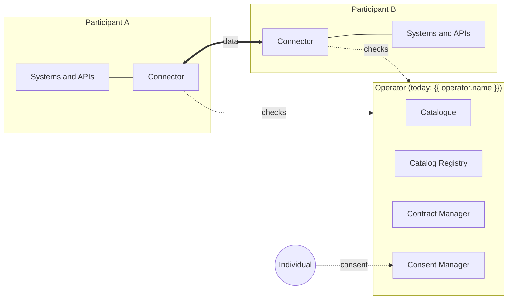

# Prometheus-X documentation

Prometheus-X is an open-source stack for building **dataspaces**: shared environments where organisations exchange data and services under rules they agreed on, and where individuals stay in control of their personal data.

This site is the technical entry point to Prometheus-X. It explains how a Prometheus-X dataspace works, what each core component does, and what your organisation needs to do to join one.

## Prometheus-X in one minute

- **A dataspace has an operator.** The operator runs a small set of shared **core services**: a catalogue where participants register and find each other, a contract manager, a consent manager, and a registry of reference models.
- **Each participant runs a connector.** The Prometheus-X Dataspace Connector (PDC) checks contracts, policies and consent before every exchange, then moves the data directly to the other participant's connector. The core services decide *who may exchange what*; they never handle the data itself.
- **Three things set Prometheus-X apart** from most dataspace protocols:
    1. **Multi-party contracts.** A use case gathers several organisations under one contract, with an orchestrator, roles and per-offer policies.
    2. **Consent-driven personal data.** An individual's consent triggers the exchange of their data, based on a privacy notice generated from the contract.
    3. **Service chains.** Data can flow through several processing services (for example an anonymiser) on its way from provider to consumer, under a single contract.

## Choose your path

-   **I am discovering Prometheus-X**

    ---

    Understand the concepts: participants, offers, use cases, contracts, consent and service chains.

    [Learn the concepts](learn/index.md)

-   **My organisation wants to join a dataspace**

    ---

    A step-by-step guide, from creating your account in a catalogue to your first data exchange.

    [Join a dataspace](participants/index.md)

-   **I am a developer setting up a connector**

    ---

    Deploy the connector, plug in your APIs and databases, and trigger exchanges.

    [Connector documentation](connector/index.md)

-   **I want to know what each component does**

    ---

    Catalogue, Catalog Registry, Contract Manager, Consent Manager and Connector.

    [Core components](components/index.md)

-   **I work on another dataspace or standard**

    ---

    How Prometheus-X relates to Eclipse DSP and EDC, Gaia-X, Simpl and DSIF, and why it has its own protocol.

    [Interoperability](interoperability/index.md)

-   **I build or maintain a building block**

    ---

    Find the building blocks around the core, and add the documentation of your own.

    [Building blocks](building-blocks/index.md)

## Who operates Prometheus-X today

Any organisation can run the core services, since they are open source. Today the reference operator is **[{{ operator.name }}]({{ operator.app_url }})**, a service by {{ operator.company }}. It runs the catalogue, contract and consent services, and can also host a connector for participants who do not want to run one. Its user documentation lives at [{{ operator.docs_url }}]({{ operator.docs_url }}).

Throughout this site, {{ operator.name }} is used as the running example of an operator.

## Open-source repositories

All core components are published under the MIT licence in the [Prometheus-X GitHub organisation]({{ ptx_github }}).

| Component | Repository |
| --- | --- |
| Dataspace Connector (PDC) | [dataspace-connector]({{ ptx_github }}/dataspace-connector) |
| Catalogue | [catalog-api]({{ ptx_github }}/catalog-api) |
| Catalog Registry | [catalog-registry]({{ ptx_github }}/catalog-registry) |
| Contract Manager | [contract-manager]({{ ptx_github }}/contract-manager) |
| Consent Manager | [consent-manager]({{ ptx_github }}/consent-manager) |
| Service chains library | [data-processing-chain-protocol]({{ ptx_github }}/data-processing-chain-protocol) |
| Local dataspace with Docker | [ptx-docker]({{ ptx_github }}/ptx-docker) |
