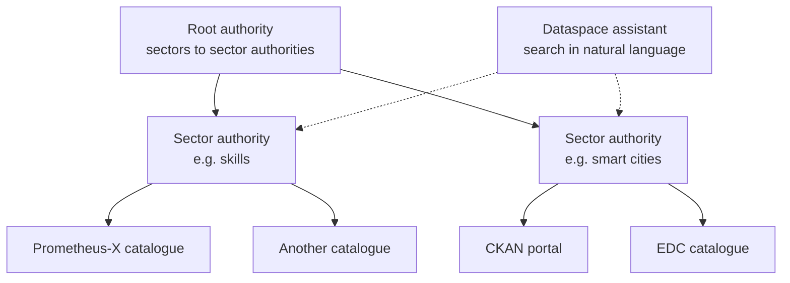

# DSIF

The **Data Space Interoperability Framework (DSIF)** aims at *actionable* interoperability between dataspace stacks: Prometheus-X, Eclipse Dataspace Components, FIWARE Data Space Components, Simpl-Open, Gaia-X, Pontus-X and Ocean, Solid and others. Its motto: "by data spaces, for data spaces".

| | |
| --- | --- |
| **Led by** | Prometheus-X |
| **Core team** | Athumi, deltaDAO, ILVO, Libelium, Orange Business, Seamware, StartinBlox, Visions |
| **Way of working** | Decisions by consensus, driven by minimum viable products and real pilots |
| **Long-term intent** | Hand the framework over to the Data Spaces Support Centre (DSSC) |
| **Base standards** | DCAT v3 and DCAT-AP, W3C DID and Verifiable Credentials, ODRL 2.2, ISO/IEC TS 27560 |
| **Specifications** | [DSIF wiki]({{ dsif_wiki }}) |

## Why DSIF

Each dataspace stack works well on its own, but participants of one cannot find, contract with or exchange data with participants of another. DSIF does not replace any stack: it defines thin, shared layers that each stack can implement on top of what it has.

## Strands

DSIF is organised in strands, one per layer.

### Catalogue federation

The most mature strand. Catalogues are organised in a hierarchy, much like DNS:

- The **root authority** maps sectors to sector authorities.
- A **sector authority** registers the catalogues of its sector, and offers discovery and federated search across them.
- Each **independent catalogue** exposes its offers as DCAT-AP JSON-LD, in the shape used by the CKAN DCAT extension, with paging and search. CKAN catalogues can join by enabling that extension; other catalogues add a thin layer.
- Every catalogue publishes a manifest at `/.well-known/dataspace-catalog.json`.
- Federated results keep their provenance: origin catalogue and federation path.

Prometheus-X offers and resources map to `dcat:DataService` and `dcat:Dataset`. A proof of concept of the root and sector authorities is running.

### Contract federation

Builds on DSP contract negotiation, with backward-compatible extensions:

- catalogue metadata saying who negotiates for an offer (the connector or an intermediary such as the Prometheus-X Contract Manager) and what it supports;
- new negotiation states and messages for counter-offers and human review;
- **multi-party** negotiation messages and agreement templates, with an orchestrator and roles;
- **delegation** of negotiation to an intermediary, with adoption levels so stacks can implement it progressively.

Mappings with TM Forum agreement APIs are worked out with FIWARE.

**Pilot.** Prometheus-X implemented the DSP Contract Negotiation Protocol, so its participants can already negotiate **bilateral** contracts with DSP connectors such as EDC, for offers found through catalogue federation. Trust between the pilot systems is configured manually, because identity federation is not solved yet. See [Eclipse DSP and EDC](dsp-and-edc.md#contract-negotiation-over-dsp).

### Consent federation

"Simple federated consent": the consent authority stays where it is (for example the Prometheus-X Consent Manager, or a Solid-based intermediary), and exposes a small REST interface to check, grant and revoke consent, advertised through the catalogue. Datasets can declare that consent is required, and agreements can carry a consent constraint with the address to check it. A consent relay between Prometheus-X and Athumi (Solid) is being piloted.

### Identity and trust

A common **DSIF assertion**: a verifiable credential in JWT form describing the participant, its connector, its roles and the purpose of a request, sent with requests between connectors of different stacks. It relies on registries of participants, connectors and trusted issuers, reuses the Gaia-X clearing houses, and avoids a central token service. This strand is a proposal under review.

### Connector and service chains

Cross-dataspace exchanges and processing chains, with the Prometheus-X service chain protocol as the reference. Early work.

## Pilots

| Pilot | Stacks involved |
| --- | --- |
| Smart cities (Kiel, Cartagena, French city portals) | FIWARE, EDC, Ocean, Prometheus-X |
| Media and skills | Prometheus-X and an EDC-based media dataspace |
| Skills and personal data stores | Prometheus-X and Solid (Athumi) |
| Agriculture (CEADS) | DjustConnect agricultural data platform |
| Health | Planned |

## Prometheus-X and DSIF

- The Prometheus-X catalogue exposes DSIF catalogue endpoints, so its offers can be federated.
- Prometheus-X negotiates bilateral contracts over DSP with other dataspaces, and the Contract Manager records these negotiations.
- The Contract Manager is the reference for the intermediary and multi-party extensions.
- The Consent Manager is one of the consent authorities in the consent relay pilot.
- The service chain protocol is the reference for the connector strand.
