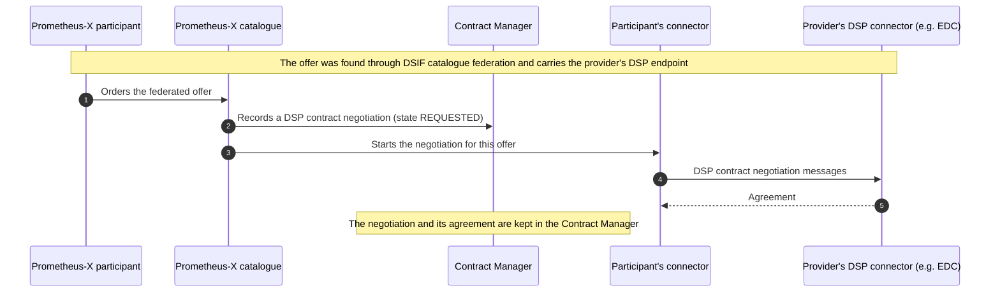

# Eclipse DSP and EDC

The **Eclipse Dataspace Protocol (DSP)** defines how connectors publish catalogues, negotiate contracts and transfer data. The **Eclipse Dataspace Components (EDC)** are its most widely used implementation. Many dataspaces, including Simpl and Catena-X, are built on them.

Prometheus-X uses its own protocol, for the reasons explained in [Why a dedicated protocol](why-a-dedicated-protocol.md). It can also negotiate **bilateral contracts over the DSP Contract Negotiation Protocol** with DSP-based dataspaces, as piloted within DSIF. This page maps the concepts of the two, describes that negotiation, and lists the other ways to make them work together.

## Concept mapping

| Prometheus-X | DSP / EDC | Notes |
| --- | --- | --- |
| Participant (catalogue record, identified by URL) | Participant (identified by a DID, with credentials) | Prometheus-X identity moves to verifiable credentials on the [roadmap](../roadmap.md) |
| Connector (PDC) | Connector (control plane and data plane) | The PDC combines both by default; control-plane-only mode separates them |
| Offer (service offering) | Dataset with an offer in the catalogue | |
| Data resource | Dataset / asset | |
| Representation and connector credential | Data address and vault secret | Same idea: the connector knows how to reach the source; the secret stays local |
| Software resource (purpose) | No equivalent | Prometheus-X describes the consumer's service; DSP does not |
| Use case (ecosystem) | No equivalent | |
| Ecosystem contract (multi-party) | No equivalent | DSP agreements are bilateral |
| Bilateral contract | Contract agreement | Can be negotiated over DSP with other dataspaces ([see below](#contract-negotiation-over-dsp)) |
| Negotiation in the catalogue | Contract negotiation between connectors | Within Prometheus-X, negotiation happens in the catalogue. With DSP-based dataspaces, the connector negotiates over DSP |
| Policy template (Catalog Registry) | Policy definition | Both ODRL-based |
| Policy evaluation in the connector | Policy engine in the control plane | |
| Exchange (trigger, export, import) | Transfer process (push or pull) | |
| Consent and privacy notice | No equivalent | |
| Service chain | No equivalent | |
| Centralised catalogue | Catalogue protocol, federated catalogue crawlers | |

## Main differences

- **Where agreement happens.** In DSP, connectors negotiate with each other. Within Prometheus-X, participants negotiate in the catalogue, an intermediary records the contract, and connectors enforce it. When a Prometheus-X participant negotiates with a DSP-based dataspace, it uses DSP, and the intermediary still keeps a record of the negotiation.
- **Who is involved.** DSP has a provider and a consumer. Prometheus-X adds the orchestrator, the operator's core services, the individual, and the intermediate nodes of a chain.
- **Where data flows.** Both move data peer to peer. EDC separates control and data planes; the Prometheus-X connector does both by default, with an optional control-plane-only mode.

## Contract negotiation over DSP

Within DSIF pilots, Prometheus-X implemented the **DSP Contract Negotiation Protocol (CNP)**. A Prometheus-X participant can negotiate a bilateral contract with a participant of a DSP-based dataspace, such as one running EDC, using standard DSP negotiation messages and states.

How it works:

- The provider's offer is discovered through [DSIF catalogue federation](dsif.md#catalogue-federation). Its description includes the DSP protocol endpoint to negotiate with.
- The participant orders the offer from the Prometheus-X catalogue.
- The catalogue records the negotiation in the [Contract Manager](../components/contract-manager.md#dsp-negotiation-records): provider and consumer process identifiers, state, offer, agreement.
- The participant's connector carries out the DSP negotiation with the provider's connector.

Current limits:

| Limit | Why |
| --- | --- |
| **Bilateral contracts only** | DSP agreements have two parties. Multi-party contracts across dataspaces need the DSIF multi-party extensions, still being specified. |
| **Trust configured manually** | Identity federation between dataspaces is not solved yet in DSIF. For the pilots, each side is configured to trust the other system. Verifiable participant identities will replace this (see [Identity and trust](dsif.md#identity-and-trust)). |
| **No consent or service chains** | DSP has no notion of individual consent or processing chains. These remain Prometheus-X-only for now. |

## Making them work together

| Level | Option | Status |
| --- | --- | --- |
| Catalogue | Exchange DCAT-AP catalogues through DSIF catalogue federation; EDC can expose its DSP catalogue as a DCAT data service | Proof of concept |
| Catalogue | The interoperability middleware converts DSP catalogue offers into Prometheus-X offers ([Simpl](simpl.md) first) | First milestone |
| Contract | [Bilateral negotiation over DSP CNP](#contract-negotiation-over-dsp), with trust between the systems configured manually | DSIF pilot |
| Contract | DSIF extensions of DSP contract negotiation: counter-offers, review states, multi-party messages, intermediary delegation | Specification in progress |
| Data | An EDC-based source behind a Prometheus-X connector: the connector's representation points at the EDC endpoint | Possible today |
| Data | Control-plane-only mode: Prometheus-X authorises, another transfer system moves the data | Connector 1.12.0 |
| Identity | Verifiable credentials and a common DSIF assertion | Planned |

See [DSIF](dsif.md) for the federation work.
