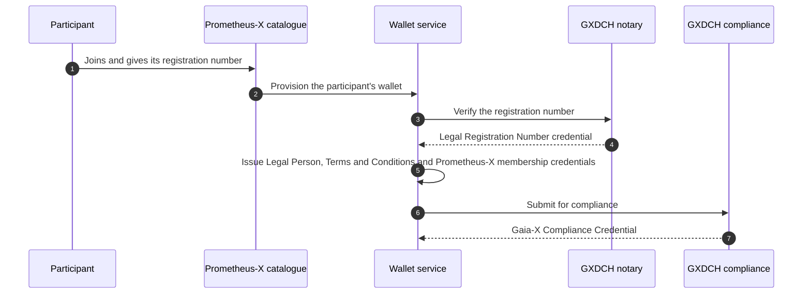

# Gaia-X

**Gaia-X** defines a trust framework for data and cloud ecosystems: a common vocabulary to describe participants and services, and compliance services (the Gaia-X Digital Clearing Houses, GXDCH) that issue verifiable credentials to participants who meet its rules.

## Today: aligned vocabulary

The Prometheus-X data model follows the naming of the Gaia-X Trust Framework:

| Prometheus-X | Gaia-X |
| --- | --- |
| Participant, with legal person fields (registration number, headquarters address, legal address) | Legal Person |
| Offer (service offering) | Service Offering |
| Data resource | Data Resource |
| Software resource | Software Resource |
| Fields such as `providedBy`, `aggregationOf`, `dependsOn`, `containsPII` | Same names |

This makes Prometheus-X descriptions easy to map to Gaia-X ones. Prometheus-X participants do not yet hold Gaia-X compliance credentials.

## Target: Gaia-X compliance for every participant

The [identity roadmap](../roadmap.md#decentralised-identity-for-participants) gives each participant a wallet with Gaia-X credentials, obtained during onboarding with no extra effort from the participant:

| Credential | Issued by |
| --- | --- |
| Gaia-X Legal Person | Prometheus-X, on behalf of the participant |
| Legal Registration Number (VAT, EORI or LEI) | A GXDCH notary |
| Gaia-X Terms and Conditions | Prometheus-X |
| Gaia-X Compliance Credential | A GXDCH |
| Prometheus-X Membership | The Prometheus-X operator that onboarded the participant |

## Compliance is not membership

A Gaia-X Compliance Credential proves that a participant is identified and conforms to the Gaia-X Trust Framework. It does not make it a member of a given dataspace. Prometheus-X therefore issues its own membership credential, which it can suspend or revoke, alongside the Gaia-X ones. Verifiers check both.

## What it enables

- A participant from another Gaia-X-aligned ecosystem can be recognised in Prometheus-X on the basis of its Gaia-X credentials, and vice versa.
- Several Prometheus-X operators can recognise each other's participants.
- Contract signatures can later be tied to verified legal identities, using the signed agreement credentials defined by Gaia-X.
