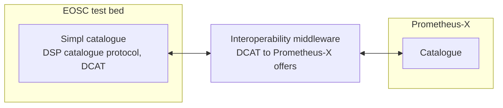

# Simpl

[Simpl](https://simpl-programme.ec.europa.eu/) is the European Commission's open-source middleware for the common European data spaces. It is built on the Eclipse Dataspace Protocol and Eclipse Dataspace Components, and is deployed, among others, by the European Open Science Cloud (EOSC).

## Why it matters for Prometheus-X

The education and skills dataspace where Prometheus-X operates can benefit from research and open-science data available through Simpl-based dataspaces: matching courses or teachers with relevant scientific publications, for example.

## Catalogue interoperability

The first step is to let Prometheus-X participants **see Simpl offers in the Prometheus-X catalogue**, using EOSC as a test bed.

The [dataspace interoperability]({{ ptx_github }}/dataspace-interoperability) building block is a middleware that:

- queries the Simpl catalogue through the DSP catalogue protocol;
- maps its DCAT datasets to Prometheus-X offers, keeping the essential metadata (title, description, keywords, distributions);
- maps Prometheus-X offers to DCAT in the other direction.

**Status:** first milestone, proof of concept.

## Next steps

- Since Simpl is built on DSP, the bilateral [contract negotiation over DSP](dsp-and-edc.md#contract-negotiation-over-dsp) piloted in DSIF is the path to agreeing on Simpl offers. It still needs trust between the systems to be configured, until identity federation is solved.
- Multi-party contracts and data exchange with Simpl connectors are part of the [DSIF](dsif.md) contract and connector work.
- Simpl-Open is one of the stacks DSIF aims to federate.
