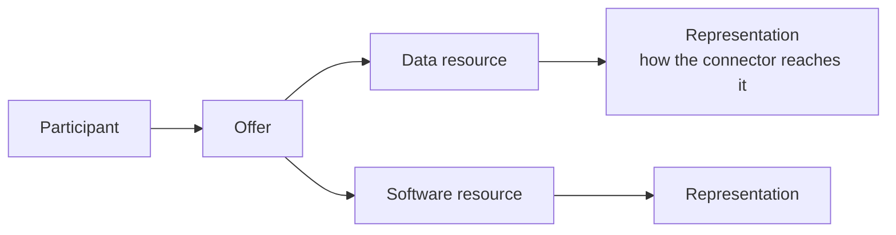

# Offers, use cases and contracts

This page explains how participants describe what they share, how they come to an agreement, and how that agreement is enforced.

## Resources and offers

Participants describe what they bring to the dataspace in the catalogue.



| Object | What it is |
| --- | --- |
| **Data resource** | A description of a unit of data: a dataset, a database, the output of an API. It states, among other things, whether it contains personal data. |
| **Software resource** | A description of a service that uses data, such as an application or an API. It is the purpose for which a consumer receives data. |
| **Representation** | The technical part of a resource: the URL the connector calls, the type of source, the format, and the identifier of the credential the connector uses. The credential itself stays in the connector. |
| **Offer** (service offering) | A package of one or more resources, with business information (such as pricing) and default policies. Only offers are visible in the catalogue; resources are not shown on their own. |
| **Infrastructure offer** | A processing service, without resources, that can be used as a step in a [service chain](service-chains.md). |

The data model follows the field names of the Gaia-X Trust Framework (participant, service offering, data resource, software resource).

## Use cases

A **use case** (called *project* or *ecosystem* depending on the tool) brings several participants together around a shared goal, for example "recommend training paths from learners' skills data".

The orchestrator who creates the use case:

1. describes it and the kinds of data and services it is looking for;
2. lists the building blocks it requires;
3. invites participants, or accepts their requests to join;
4. negotiates with each one which of their offers are used and under which policies;
5. defines roles and the obligations attached to them;
6. optionally builds [service chains](service-chains.md);
7. signs the use-case contract, as every member does.

Invitations and join requests follow the same steps: pending, then authorised or rejected, then signed.

## Contracts

Every exchange is based on a signed contract stored in the [Contract Manager](../components/contract-manager.md). There are two kinds.

| | Ecosystem contract | Bilateral contract |
| --- | --- | --- |
| **Parties** | All members of a use case, including the orchestrator | One provider and one consumer |
| **Content** | Members and their roles, the offers each member brings with their policies, role obligations, service chains | The provider's offer, the consumer's purpose, the policies |
| **Signed when** | The orchestrator and at least one other member have signed | Both parties have signed |
| **Created by** | The catalogue, when the use case is published | The catalogue, when the provider accepts the consumer's request |

### Negotiation

Policies and pricing are proposed and counter-proposed in the catalogue. If a party changes any value in a proposal, it cannot accept that proposal and must send a counter-offer instead. Once both sides accept, they sign. The catalogue then writes the agreed policies into the contract: this step is called **policy injection**.

Offers become usable in exchanges only once the contract is signed. A renegotiation needs a new signature.

### Revocation

A participant can revoke its signature. The contract then becomes *revoked* and the connectors refuse any further exchange under it. In an ecosystem contract, a single member's revocation currently revokes the whole contract.

## Policies

Policies say how an offer may be used. They are written in a JSON form of **ODRL**, the W3C Open Digital Rights Language, with permissions, prohibitions, constraints and duties.

Participants do not write policies by hand. They pick **policy templates** from the [Catalog Registry](../components/catalog-registry.md) and fill in the values. For example:

| Template | Meaning |
| --- | --- |
| No restriction | The data may be used without constraint (the default for new offers) |
| Time interval | The data may be used only between two dates |
| Count | The data may be used at most N times |
| Subscription | Use requires an active subscription |
| Compensation | Use requires a payment |

Templates come in three families: **access** rules (how data may be used), **billing** rules (subscription and payment) and **responsibility** rules (the obligations attached to a role in a use case).

A filled-in template looks like this in the contract:

```json
{
  "permission": [{
    "action": "use",
    "target": "https://catalogue.example/v1/catalog/serviceofferings/123",
    "constraint": [{ "leftOperand": "count", "operator": "lt", "rightOperand": 10 }]
  }]
}
```

### Enforcement

Policies are enforced by the connectors, not by a central service. On each exchange, the connector fetches the current contract and evaluates the policies of the offer locally:

- usage counters are kept by the connector;
- billing conditions are checked against a billing service the participant configures;
- if a policy is not satisfied, the exchange stops before any data moves.

## Signatures

Today the Contract Manager records each party's signature when the catalogue sends it. Signatures with verifiable credentials, linked to the legal identity of the signer, are part of the [identity roadmap](../roadmap.md).
