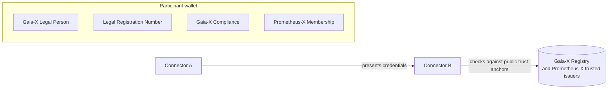

# Identity and trust

Two questions underlie every exchange: *who is this participant?* and *what is it allowed to do?* Prometheus-X answers them separately.

- **Authorisation** (what a participant may do) comes from contracts, policies and consent. See [Offers, use cases and contracts](contracts-and-policies.md) and [Personal data and consent](personal-data-and-consent.md).
- **Identity** (who a participant is) is described on this page.

## How identity works today

| Who | Where the identity lives | How it is used |
| --- | --- | --- |
| **Organisations** | Their account in the operator's catalogue | The catalogue issues each organisation a pair of API keys (a service key and a secret key). |
| **Connectors** | The organisation's catalogue record, which stores the connector's address | The connector authenticates to the core services with its organisation's keys and registers itself when it starts. |
| **Individuals** | Their account in the Consent Manager | Identified by email. Each organisation they deal with keeps its own identifier for them; the Consent Manager links them. |

Participants and resources are identified by the URL of their description in the catalogue, for example `{{ operator.catalog_uri }}catalog/participants/{id}`. Contracts and consents use these URLs.

### What this implies

- **Trust is placed in the operator.** The operator onboards organisations and vouches for them.
- **One dataspace, one operator.** An organisation onboarded by one operator is not known to another.
- **Identity is not portable.** It is an account in the operator's catalogue, not something the organisation carries with it.

These are the limits the roadmap addresses.

## Where we are going

Prometheus-X is moving organisations' identity into **wallets holding verifiable credentials**, in collaboration with Orange and its Live Identity Wallet.

- Each participant has its own wallet space, with its own keys and credentials. Participants do not need to manage certificates or keys to join.
- Credentials include Gaia-X compliance credentials and a revocable Prometheus-X membership credential.
- Before an exchange, connectors present their credentials to each other and verify them against public trust anchors. No call to the onboarding operator is needed.
- Several operators can issue membership credentials, which opens the way to multi-operator dataspaces.
- It relies on open standards: W3C Verifiable Credentials, OID4VCI, OID4VP and `did:web`.

Individuals are out of scope for this first step; personal wallets such as the EU Digital Identity Wallet may follow.

See the [Roadmap](../roadmap.md) and [Gaia-X](../interoperability/gaia-x.md).

## Across dataspaces

For exchanges between different dataspaces, DSIF is working on a common identity assertion based on verifiable credentials, which connectors of different stacks can exchange and verify. See [DSIF](../interoperability/dsif.md#identity-and-trust).
