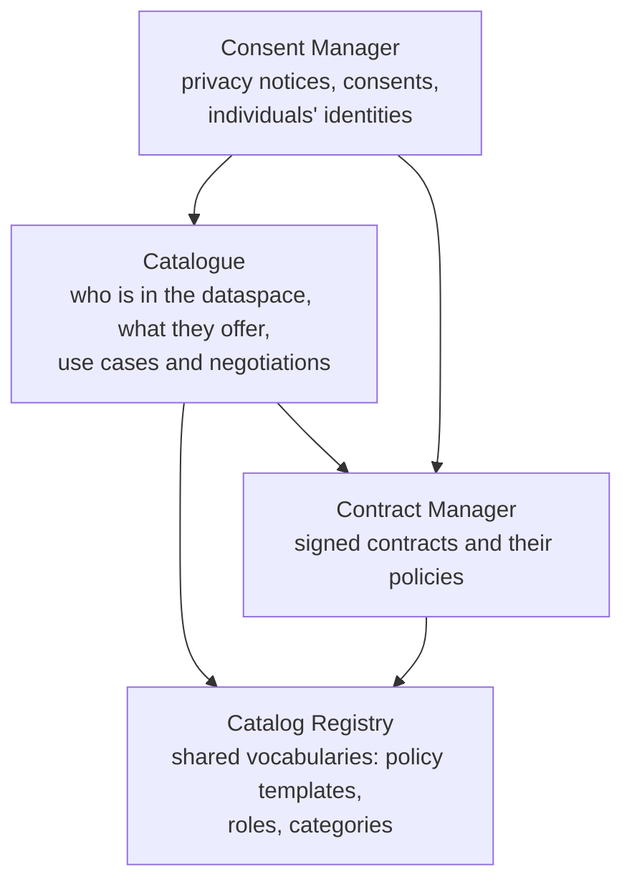
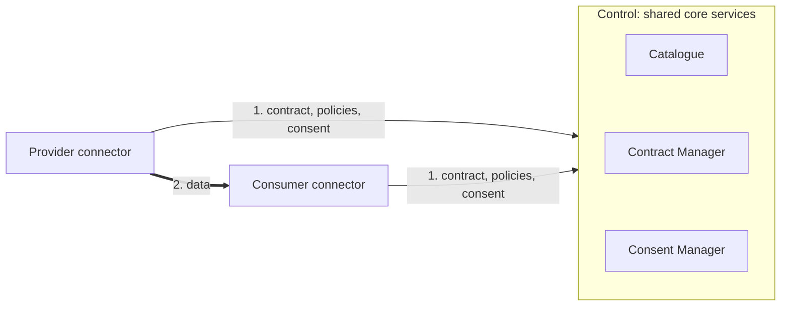
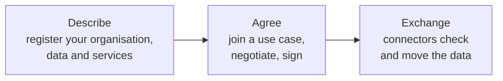

# How a Prometheus-X dataspace works

This page gives you the mental model behind Prometheus-X. Read it first: the rest of the documentation builds on it.

## The actors

A Prometheus-X dataspace involves four kinds of actors.

| Actor | What it does |
| --- | --- |
| **Operator** | Runs the core services that everyone in the dataspace relies on. Today this is {{ operator.name }}. |
| **Participants** | Organisations that share data, offer services that use data, or provide infrastructure services. Each one runs (or rents) a connector. |
| **Orchestrators** | Participants that set up a *use case*: they gather other participants around a shared goal and define the rules. |
| **Individuals** | People whose personal data is exchanged. They give or refuse consent through a personal data intermediary. |

See [Roles](roles.md) for the details.

## The core services

The operator runs four services. Together, they act as a trusted intermediary: they know who is in the dataspace, what is on offer, what has been agreed, and what individuals have consented to.

- **Catalogue**: participants register, describe their data and services as *offers*, discover each other, build use cases and negotiate. It is also where each organisation's identity lives today.
- **Catalog Registry**: the shared reference models of the dataspace, such as policy templates (for example "may be used at most N times"), roles and categories.
- **Contract Manager**: stores the contracts once they are signed, with the policies that apply to each offer.
- **Consent Manager**: generates privacy notices from contracts, records individuals' consents and starts consent-based exchanges.

Each is described in [Core components](../components/index.md).

## The connector

Every participant uses a **Prometheus-X Dataspace Connector (PDC)**. It sits between the participant's own systems and the rest of the dataspace. Before each exchange, it:

1. fetches the contract from the Contract Manager;
2. checks that the requested exchange is allowed by the contract and its policies;
3. checks consent, when personal data is involved;
4. pulls the data from the provider's system and delivers it to the consumer's system, connector to connector.

See [Connector](../connector/index.md).

## Control is shared, data is peer to peer

The core services answer *who may exchange what, under which contract and which consent*. The data itself moves directly between the participants' connectors. The operator does not store or relay the data being exchanged.

## The lifecycle: describe, agree, exchange

1. **Describe.** Participants register in the catalogue and publish *offers* that describe their data or services.
2. **Agree.** An orchestrator creates a use case and invites participants, or participants ask to join. They negotiate which offers are used and under which policies, then sign. Two participants can also agree on a bilateral contract.
3. **Exchange.** Once the contract is signed, connectors can exchange data. When the data is personal, the individual's consent triggers the exchange.

## Design principles

**Contract first.** No exchange and no consent can happen without a signed contract. The connector fetches the contract on every exchange, so a revoked contract stops exchanges immediately.

**Everything has a public description.** Participants, offers, resources, use cases and contracts are identified by web addresses (URLs) that return their description. Contracts and consents refer to participants and offers by these URLs.

**The catalogue knows where data lives, not the secrets to reach it.** A resource's technical description says which endpoint the connector should call. The credentials to call it stay in the participant's own connector.

**The operator is replaceable.** The core services are open source and any organisation can run them. Today each dataspace has one operator; federation between operators is the purpose of the [identity roadmap](../roadmap.md) and of [DSIF](../interoperability/dsif.md).

**Built for consent and multi-party agreements.** Prometheus-X uses its own exchange protocol, because standard dataspace protocols do not cover personal data consent, multi-party contracts or service chains. See [Why a dedicated protocol](../interoperability/why-a-dedicated-protocol.md).

## Technology

All core components are Node.js and TypeScript services with REST and JSON APIs, MongoDB storage, Docker images and OpenAPI (Swagger) documentation. They are published under the MIT licence.
