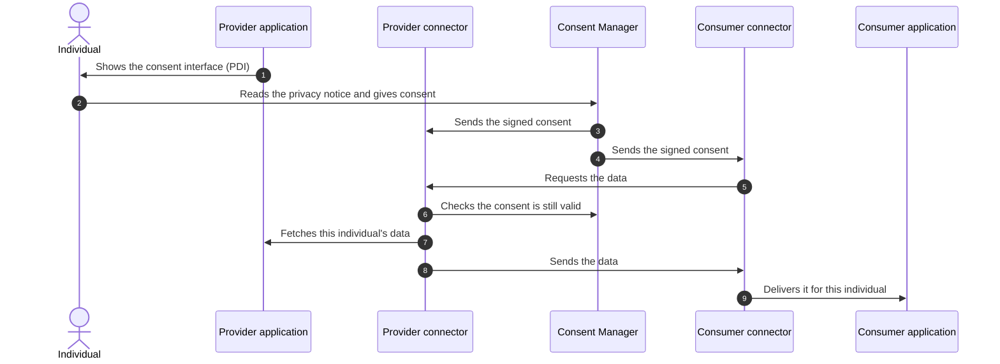

# Personal data and consent

Prometheus-X lets organisations exchange an individual's personal data **because that individual asked for it**. A learner can, for example, send their skills record from a training platform to a career-guidance service. This page explains how.

## The principle

- Personal data is exchanged **only with the individual's consent**, and the consent itself triggers the exchange.
- The consent is always based on a **signed contract** between the organisations. The contract defines which data goes where, and for what purpose.
- The individual sees a **privacy notice** generated from that contract, so what they agree to matches what the organisations signed.
- Each organisation keeps its own user accounts. Prometheus-X links the accounts of the same person across organisations without merging them.

Offers that contain personal data cannot be exchanged through the standard business-to-business flow: connectors refuse them and require the consent flow.

## What the individual sees

The individual manages consent in a **personal data intermediary (PDI)**, an interface provided by the [Consent Manager](../components/consent-manager.md). Participants embed it in their own application (in a frame or by redirection).

In the PDI, the individual:

1. reads the privacy notice: who provides the data, who receives it, which data, for which purpose, and through which processing steps;
2. gives or refuses consent;
3. later reviews their consents and withdraws them.

## How a consent becomes an exchange

The connectors check the consent again just before the data moves, so a withdrawn consent stops the exchange.

## Privacy notices

The Consent Manager generates privacy notices automatically from signed contracts:

| Privacy notice field | Taken from |
| --- | --- |
| Data | The provider's data resources covered by the contract |
| Purposes | The consumer's software resources (the services that will use the data) |
| Recipients | The consumer |
| Processing steps | The service chains defined in the contract |

When the data covered by a contract changes, a new version of the notice is created. Fields that a contract does not contain, such as retention period or data protection officer, have to be completed by the organisations.

## Consent records

Each consent is stored with its history (given, withdrawn, and so on) and can be exported as a receipt that follows the structure of **ISO/IEC TS 27560**, the standard for consent records. Possible statuses are pending, draft, granted, refused, revoked, expired and terminated.

## Linking the same person across organisations

A person usually has a different account at the provider and at the consumer. The Consent Manager links them:

1. Each participant registers its users through its connector, with the user's email and the participant's own internal identifier.
2. The Consent Manager groups the accounts with the same email into one person.
3. When the data is delivered, each connector translates back to its own internal identifier, so applications never handle another organisation's identifiers.

If the person is not yet known to the consumer, the consumer's application can be asked to create the account on the fly, and the exchange resumes once it is done. If the person uses a different email at the consumer, they can enter it in the consent interface and confirm it by email.

## Current scope

- The legal basis handled is **consent**. Other legal bases are not modelled yet.
- One person acting for another, such as a parent for a minor, is not modelled yet. Work on parental consent is under way.
- Individuals have an account in the Consent Manager. Support for personal wallets (such as the EU Digital Identity Wallet) is future work.

## What participants need to do

See [Personal data (optional)](../participants/personal-data.md) in the participant guide.
