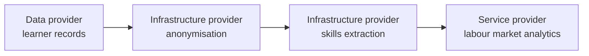

# Service chains

A **service chain** sends data through one or more processing services on its way from a provider to a consumer, all under a single use-case contract.

Typical uses: anonymising or pseudonymising data before it reaches the consumer, converting formats, enriching data, running a computation close to the data (edge computing), or checking data quality.

## Who does what

| Actor | Role in a chain |
| --- | --- |
| **Infrastructure provider** | Publishes an *infrastructure offer* in the catalogue: input and output formats, limits, pricing, and the parameters a chain can set. Runs the service behind its own connector. |
| **Orchestrator** | Builds the chain in the use case: picks the nodes, their order and their parameters. The chain is stored in the use-case contract. |
| **Connectors** | Run the chain. Each connector reads the contract to find the next step, calls its own participant's service, and forwards the result. |

All members of the chain must have signed the use-case contract before it can run.

## How a chain runs

1. The exchange is triggered with a reference to the chain.
2. The first connector checks the contract and policies, fetches the data and sends it to the next node.
3. Each intermediate connector checks that its service is part of the chain in the contract, re-checks consent when personal data is involved, and calls its service with the data and the chain parameters.
4. The service processes the data and hands the result back to its connector, which forwards it to the next node.
5. The last connector delivers the result to the consumer's application.

Chains are run by the **Data Processing Chain Protocol (DPCP)**, an open-source library built into the connector.

## Implementing a node

A service in the middle of a chain receives the data from its connector, processes it, and tells the connector to resume the chain with the result. Two options:

- **Asynchronous services** call the connector back when they are done.
- **Fast synchronous services** can let the connector handle this automatically, by enabling the connector's service chain adapter.

See [Exchange flows](../connector/exchange-flows.md#service-chains) for the technical details.

## Chains and consent

When a chain carries personal data, its processing steps appear in the privacy notice. If several chains are possible, the individual can choose one when giving consent.

## Current scope

- Chains carry JSON data.
- Chains are linear: each node receives one input. A node cannot merge several upstream services, and chains cannot be nested.
- A node can pull additional data from other providers before processing, and the connector merges it with the main input.
