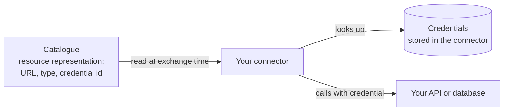

# 4. Connect your systems

Your connector now runs, but it does not yet know where your data is or where to deliver the data you receive. You tell it through the **representation** of each resource in the catalogue, and, when your systems need authentication, through **credentials** stored in the connector.



## 1. Create credentials in your connector

If your API needs authentication, create a credential in your connector. The connector returns an identifier.

```bash
curl -X POST https://your-connector.example/private/credentials \
  -H "Authorization: Bearer <connector admin token>" \
  -H "Content-Type: application/json" \
  -d '{ "type": "apiKey", "key": "x-api-key", "value": "<your API key>" }'
```

| Type | `key` | `value` |
| --- | --- | --- |
| `apiKey` | Header name | API key |
| `basic` | Username | Password |
| `proxy` | Proxy username | Proxy password |

You only put the credential's **identifier** in the catalogue. The secret itself never leaves your connector.

See [Connect your applications](../connector/applications.md#credentials) for how to obtain the admin token and manage credentials.

## 2. Fill in the representation of each resource

In the catalogue, open each resource and fill in its technical settings ("Tech" tab in {{ operator.name }}).

**For a data resource** (where your connector fetches the data):

| Field | Example |
| --- | --- |
| Source type | `REST` |
| URL | `https://api.example.org/learners/{userId}/skills` |
| Security | None, or API key with the credential identifier |
| Format | `application/json` |

**For a software resource** (where your connector delivers the data it receives): the same fields, pointing at the endpoint of your application that accepts the incoming data.

Useful details:

- `{userId}` in a URL is replaced at exchange time with your own identifier for the user concerned. Use it for personal data.
- You can allow query parameters that the consumer may pass at exchange time, for example a date range.
- A data resource can be marked as the **payload for an API**: your data is then sent to a service provider's API, and the API's response comes back to an address you set. This is the *API consumption* flow.

See the {{ operator.name }} guide on [setting up technical resources]({{ operator.docs_url }}/guide/setting-up-technical-resources.html) and [Connect your applications](../connector/applications.md) for all options.

## 3. Prepare your endpoints

- **Data endpoints** should answer a `GET` from your connector with the data.
- **Delivery endpoints** of your application should accept a `POST` from your connector with the data it received.
- Your connector adds headers describing the exchange (such as the exchange and contract identifiers) so your application can log and trace each exchange.

Your endpoints only need to be reachable by your own connector, not by the rest of the internet.

## Next step

[5. Run your first exchange](first-exchange.md)
