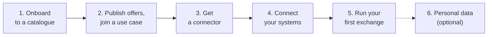

# Join a dataspace

This guide takes your organisation from "we want to join" to "our first data exchange worked". It uses {{ operator.name }} as the example operator; other operators follow the same steps.

## The steps

| Step | What you do | Who in your organisation | Effort |
| --- | --- | --- | --- |
| [1. Onboard to a catalogue](onboarding.md) | Create your organisation's account | Anyone authorised to represent it | Minutes |
| [2. Offers and use cases](offers-and-use-cases.md) | Describe your data or services; join or create a use case; negotiate and sign | Business or product owner | Days, depending on negotiation |
| [3. Get a connector](get-a-connector.md) | Deploy your own connector, or use a hosted one | Developer or IT | An hour to a day |
| [4. Connect your systems](connect-your-systems.md) | Tell the connector how to reach your APIs or databases | Developer | Hours |
| [5. Run your first exchange](first-exchange.md) | Test, then exchange data | Developer | Hours |
| [6. Personal data](personal-data.md) | Register your users and add the consent interface to your application | Developer | Days |

Steps 1 and 2 are done in the catalogue's web interface and need no technical skills. Steps 3 to 6 are technical. The two tracks can run in parallel.

## Which participant are you?

=== "Data provider"

    You have data that others could use.

    - Describe each dataset or API as a **data resource**, and package them in **offers**.
    - Say whether the data is personal: if it is, it can only be exchanged with the individual's consent.
    - Your connector fetches the data from your system when an exchange is allowed.

=== "Service provider"

    You have an application or a service that uses data from others.

    - Describe your service as a **software resource**, and package it in an **offer**. This is the *purpose* for which you receive data.
    - Your connector delivers the data it receives to your application.

=== "Infrastructure provider"

    You offer a processing service that others can insert into a [service chain](../learn/service-chains.md), such as anonymisation.

    - Publish an **infrastructure offer**.
    - Your connector calls your service with the data and forwards the result.

=== "Orchestrator"

    You want to set up a use case that gathers several organisations.

    - Create a **use case**, invite participants or accept their requests, negotiate and sign.
    - You may never exchange data yourself: you set the frame in which others do.

## Before you start

- An organisation that can sign agreements with the other participants.
- For the technical steps: a developer who can call REST APIs, and either a server to host a connector or the option to use a hosted one.
- An idea of what you want to share or use, and with whom. The catalogue helps you find partners, but use cases usually start from an existing project or partnership.
